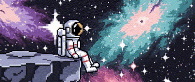
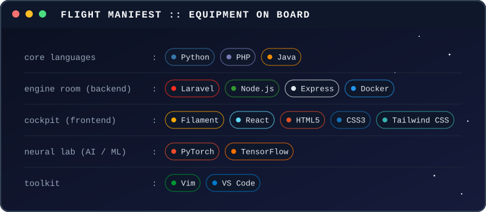
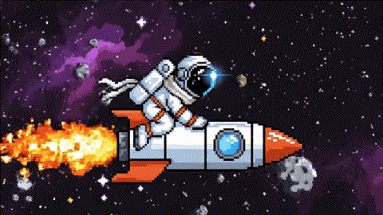

  

  

✦ &nbsp;·&nbsp; ✧ &nbsp;·&nbsp; ✦

## 🛰️ Mission Briefing

I'm a Computer Science student who turns ideas into working software, from the database to the interface to the model behind it. I build full-stack web apps and I integrate machine learning and AI into them, aiming for software that is practical, maintainable, and meaningful to the people who use it.

> *Great software is built through curiosity, consistency, and continuous learning.*

<b>🎯 Current mission: 365-Day Zero-to-Hero Software Engineering</b> (click to expand)

 

- [x] Launch the journey and commit to daily practice
- [ ] Study every single day
- [ ] Build real projects, not just tutorials
- [ ] Practice data structures and algorithms
- [ ] Deepen my understanding of software engineering, one step at a time

✦ &nbsp;·&nbsp; ✧ &nbsp;·&nbsp; ✦

## 🚀 Flight Manifest

  

✦ &nbsp;·&nbsp; ✧ &nbsp;·&nbsp; ✦

## 🧪 Active Missions

| Mission | Lab | Status |
|:--------|:----|:-------|
| ⚽ **AFC Nations League Predictor** | 🧠 Neural lab (AI / ML) |  |

<!--
WHEN THE PROJECT IS DONE, replace the badge above with this one:

-->

✦ &nbsp;·&nbsp; ✧ &nbsp;·&nbsp; ✦

## 📡 Telemetry

<table align="center">
  <tr>
    <td align="center">
      
    </td>
    <td align="center">
      
    </td>
  </tr>
  <tr>
    <td colspan="2" align="center">
      
    </td>
  </tr>
</table>

✦ &nbsp;·&nbsp; ✧ &nbsp;·&nbsp; ✦

## 📻 Open Channel

Have an idea, a project, or something to build together? The channel is open.

  

---

  🌌 Signal received: 
  

---

  

<!-- Proudly created with GPRM ( https://gprm.itsvg.in ) -->
